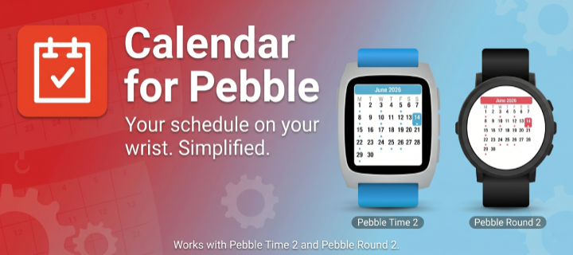

# Sundial for Pebble

A touch calendar watchapp for **Pebble Time 2** and **Pebble Round 2**.

> **Sundial** is a fork of [_Calendar for Pebble_](https://github.com/alex523ap/calendar-for-pebble)
> by alex\_pavlov, extended with native phone calendar support via the Pebble plugin API.

Shows the month with a dot on every day that has events; tap a day for an agenda you can
scroll through, and tap an event for its details (time, location, description) on a card
modelled on the system timeline's. Two calendar sources:

- **Phone calendar** — reads events directly from your device's calendar app via the
  [Pebble plugin API](https://github.com/coredevices/mobileapp/blob/master/test-apps/plugins.md).
  No links to configure; just grant calendar access once.
- **iCloud / ICS links** — the original mode; paste a `webcal://` or ICS URL.

## Screenshots

### Pebble Time 2 (emery)

|            Month (Mon start)            |            Month (Sun start)            |              Day agenda               |
| :-------------------------------------: | :-------------------------------------: | :-----------------------------------: |
| 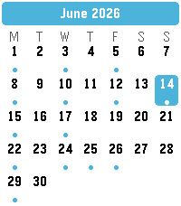 | 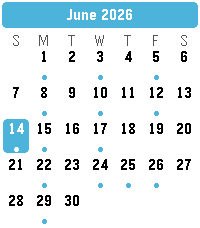 | 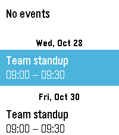 |

### Pebble Round 2 (gabbro)

|            Month (Mon start)             |            Month (Sun start)             |               Day agenda               |
| :--------------------------------------: | :--------------------------------------: | :------------------------------------: |
| 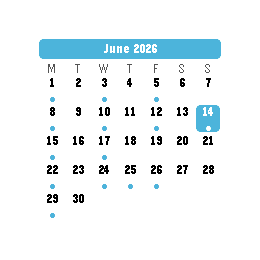 | 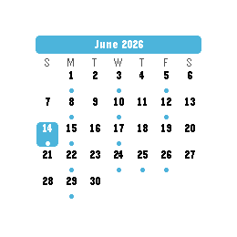 |  |

### Event details

Selecting an event opens a card laid out like the system timeline's calendar pin: a glance
page (start/end, title, location) and, one press down, the full details with the description.

|                Emery – glance                |                 Emery – details                 |                Gabbro – glance                |                 Gabbro – details                 |
| :------------------------------------------: | :---------------------------------------------: | :-------------------------------------------: | :----------------------------------------------: |
| 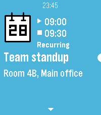 | 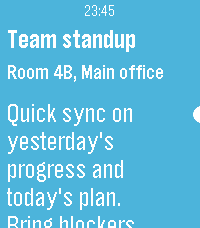 | 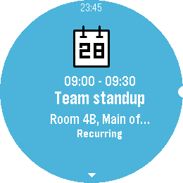 | 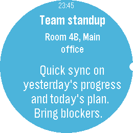 |

### Accent colours

The accent colour is used throughout the app — month title, today, agenda selection, event
card — with white or black text picked automatically for contrast.

|                 Red                  |                  Green                  |
| :----------------------------------: | :-------------------------------------: |
| 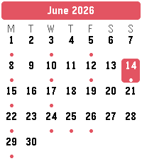 | 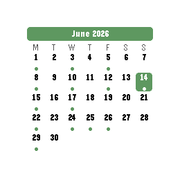 |

## Install

Sideload the prebuilt **[`calendar.pbw`](calendar.pbw)** with the Pebble app or the developer
tools:

```sh
pebble install --phone <your-phone-ip> calendar.pbw
```

Or build from source (requires the [Pebble SDK](https://developer.repebble.com)):

```sh
pebble build
pebble install --emulator emery      # or gabbro
```

## Setup — adding your calendars

Open the **Pebble mobile app → My Apps → Sundial → ⚙︎ Settings**, choose a calendar source
(Phone calendar or ICS links), set your **week start** and **accent colour**, then **Save**.

### Phone calendar (recommended)

Select **Phone calendar** and tap **Save**. The Pebble app will ask for calendar access the
first time the watch requests data. Once granted, upcoming events appear automatically.

> **Note:** The Pebble plugin API returns at most the next 10 events within a 7-day window,
> so month-view dots will only appear for the coming week. Day-detail events are fully accurate
> for any event within that window. The plugin provides title, times, location and calendar
> name but no description, so event cards show no notes in this mode (ICS links do).
> Requires **Pebble app v1.16 or later** with the **Plugins preview** feature enabled
> (Settings → Plugins → Plugins / permissions preview).

### iCloud / ICS links (original mode)

Select **iCloud / ICS links** and paste one or more calendar URLs. Multiple URLs are merged.
The app accepts a `webcal://…` link, a direct `.ics` URL, a Google share link, or a Google
"secret iCal" address.

### iCloud calendar link

1. **iPhone:** Calendar app → **Calendars** → tap the **ⓘ** next to a calendar → enable
   **Public Calendar** → **Share Link** → Copy.
2. Paste the `webcal://…` link into a calendar row in Settings.
   _(Public sharing is read-only and needs no password.)_

### Google calendar link

On a computer at **calendar.google.com**:

1. Hover the calendar → **⋮** → **Settings and sharing**.
2. **Easiest (public):** under **Access permissions**, tick **Make available to public**, then
   copy the share link (the `…?cid=…` URL) — the app converts it automatically.
3. **Private (keep it unlisted):** scroll to **Integrate calendar** → copy **Secret address in
   iCal format** (ends in `.ics`).
4. Paste the link into a calendar row in Settings.

> A Google share/`cid` link only works if the calendar is **public**. To keep a calendar
> private, use its **Secret iCal address** instead.

## Controls

- **Tap** a day → open its agenda.
- **Swipe up / down** in the agenda → next / previous day with events.
- **Tap** (or **Select**) an event in the agenda → open its details card.
- **Up / Down** (or **swipe**) on the card → glance ↔ details, then scroll the description.
- **Swipe left → right** (or **Back**) → go back one screen.
- **Swipe left / right**, or the **Up / Down** buttons, on the month → previous / next month.

## How it works

All processing happens off-watch in PebbleKit JS (the watch only renders).

**ICS mode:** PKJS fetches each ICS feed, expands recurrence (`RRULE`/`EXDATE`) and resolves
timezones, then sends the watch a compact per-day summary for the grid and, on demand, a
single day's events for the agenda — keeping every Bluetooth message small. An event's
location and description are only sent when you open it.

**Phone calendar mode:** PKJS subscribes to the built-in `calendar/event` plugin source
(`Pebble.subscribeToSource`) instead of fetching ICS. Events arrive as plugin instances with
`starts_at`/`ends_at` timestamps and are converted to the same internal format. Recurrence
expansion is handled by the platform before the data reaches PKJS.

## Project layout

```
src/c/pebble-calendar.c   watch UI (month grid, agenda, event card, settings, AppMessage)
src/pkjs/index.js         PebbleKit JS: fetch/subscribe, AppMessage, config flow
src/pkjs/ics.js           iCalendar parsing + recurrence + VTIMEZONE
src/pkjs/gcal.js          Google share-link → ICS URL normalisation
src/pkjs/config.js        settings page (source picker, week start, accent)
pkjs-test/                node unit tests (run: node pkjs-test/test-ics.js)
```

## Credits

- Original _Calendar for Pebble_ by [alex\_pavlov](https://github.com/alex523ap)
  ([alex523ap/calendar-for-pebble](https://github.com/alex523ap/calendar-for-pebble)) — MIT
  licence. Sundial builds on its month grid, agenda, ICS parsing and settings page.
- Event details card modelled on the calendar pin card of
  [PebbleOS](https://github.com/coredevices/pebbleos) (© Google LLC and contributors,
  Apache-2.0): layout, spacing, fonts, the start/end marker shapes and the calendar icon
  (redrawn from `Pebble_66x66_Empty_calendar.svg`) follow `calendar_layout.c` and
  `timeline_layout.c`.
- App menu icon adapted from [pebble-dev/iconography](https://github.com/pebble-dev/iconography)
  (Apache-2.0).
- Watch screenshots for the banner created using <https://pebble-render.aru.dev/>.

## License

[MIT](LICENSE)
